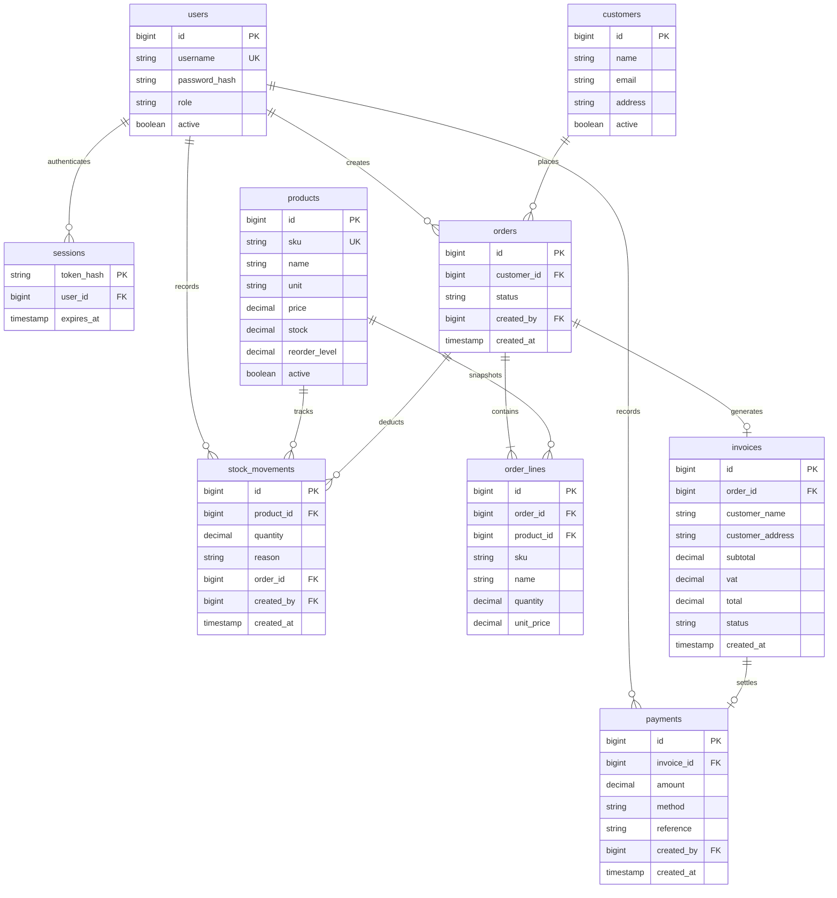

# Siam Bean Co. — Mini ERP

A full-stack classroom ERP for a coffee-bean distributor: sales, inventory, invoices, payments and a dashboard share one PostgreSQL database.

## Submission

- Public repository: https://github.com/treetest94-svg/Siam-Bean-ERP
- Public application: deployment URL will be recorded after verification.
- [Demo script](docs/DEMO.md) · [User stories and acceptance criteria](docs/SPEC.md) · [Team handover](docs/TEAM.md)
- Credentials are delivered privately to the project owner. **No passwords, keys, personal data or real customer records belong in this repository.**

## Features

- Four authenticated roles: Admin, Sales, Warehouse and Accountant. Disallowed actions return HTTP 403 from the backend and database gateway.
- Create, list, edit and deactivate products/customers; required-field, unique-SKU and numeric validation.
- Manual stock-in with movement history and low-stock badges.
- Draft sales orders with multiple lines and server-sourced price snapshots.
- Atomic confirmation: lock order and products, check stock, reduce stock, append movements, create one invoice, confirm order. Insufficient stock changes nothing. Confirmation is idempotent; concurrent orders cannot oversell.
- Numbered invoices with frozen order lines, subtotal, rounded 7% VAT, total and print layout (browser Print → Save as PDF).
- Full-payment recording and Paid status; partial and duplicate payments are rejected. No real funds are transferred.
- Five database-derived dashboard values; sales today uses Asia/Bangkok.
- Responsive interface, searches, loading/error feedback, and role-aware actions.

## Architecture

React 19 + TypeScript + Vite → same-origin FastAPI → Supabase PostgreSQL.

The app uses the isolated `siam_erp` schema in the owner's existing Supabase project. Existing Kanban tables are untouched. The backend uses a publishable key; no service-role key is needed. The schema is not exposed through the table Data API. A fixed-action database gateway authenticates each request and performs role checks before any data operation.

### Permission matrix

| Action | Admin | Sales | Warehouse | Accountant |
|---|---|---|---|---|
| View operational records/dashboard | Yes | Yes | Yes | Yes |
| Manage products | Yes | No | No | No |
| Manage customers | Yes | Yes | No | No |
| Create/confirm orders | Yes | Yes | No | No |
| Receive stock | Yes | No | Yes | No |
| Record full payments | Yes | No | No | Yes |

### ER diagram — actual tables in `siam_erp`



One company is supported. `INV-` and `SO-` numbers derive from identity IDs. Invoice lines reference immutable confirmed order lines; editing a product never changes an issued invoice. Full-payment-only scope gives at most one payment per invoice.

## Run locally

Prerequisites: Node.js 24, Python 3.12 and uv.

```bash
cp backend/.env.example backend/.env
# Configure SUPABASE_URL and SUPABASE_PUBLISHABLE_KEY in the ignored .env.
uv venv
uv pip install -r requirements.txt uvicorn
npm ci --prefix frontend
# Terminal 1:
uv run uvicorn backend.main:app --host 0.0.0.0 --port 8000
# Terminal 2:
npm run dev --prefix frontend
```

Vite proxies `/api` to port 8000. Production uses FastAPI's frontend mount and one origin. Build with `npm run build`. `vercel.json` includes built frontend assets in the Python function.

Apply `database/schema.sql` once to a fresh database. Create accounts using **locally generated bcrypt hashes** in `siam_erp.users`; never commit the passwords or hashes. Do not rerun schema creation against an existing installation. The hosted database has already been provisioned.

## API

`POST /api/{action}` accepts a JSON object. Actions: `login`, `logout`, `me`, `state`, `product_save`, `product_active`, `customer_save`, `customer_active`, `stock_in`, `order_create`, `order_confirm`, `payment_create`. `GET /api/health` checks server availability; authenticated `POST /api/health` checks database access. See `/docs` for the transport API and `database/schema.sql` for validation and transaction rules.

Authentication uses a random 256-bit session token in an HttpOnly, SameSite=Lax cookie (Secure on Vercel). Only a SHA-256 token hash is stored; sessions expire after eight hours and logout revokes them. Passwords are bcrypt-hashed. Role assignments are database-controlled, never supplied by the client. Cross-origin writes are rejected.

## Verification

`tests/integration.py` exercises the real database, not a mock. It supports a locally mounted FastAPI app or a deployed origin:

```bash
ERP_TEST_CREDENTIALS=/private/accounts.json .venv/bin/python tests/integration.py
ERP_TEST_CREDENTIALS=/private/accounts.json ERP_BASE_URL=https://your-app.vercel.app .venv/bin/python tests/integration.py
```

The private JSON maps the four role usernames to their passwords. Tests create identifiable QA data and deactivate their product/customer records. Run in a separate testing database when you need an untouched demo. Never place the credential JSON in this repository.

## Security and scope notes

- This is a one-company classroom ERP with synthetic records, not a production accounting system.
- RLS is enabled with no table grants/policies: direct access is deliberately denied. The authenticated gateway is the only application access path.
- Supabase advisors flag the intentional SECURITY DEFINER gateway: it requires valid credentials/session tokens, fixes its search path, uses static SQL and enforces role permissions. See [advisor guidance](https://supabase.com/docs/guides/database/database-linter?lint=0028_anon_security_definer_function_executable).
- Login throttling is per application instance; a production rollout should use shared rate limiting, account recovery, stronger audit retention and dedicated accounts per person.
- No signup, multi-tenancy, purchasing, email delivery, discounts or partial payments. These are outside the minimum scope.
- AI-assisted implementation. Third-party Matt Pocock skills were not installed or executed. Do not claim otherwise. Tests were added after the initial implementation, not presented as a fabricated TDD history.
- Team members must make their own genuine contributions and explain the code; see `docs/TEAM.md`.
